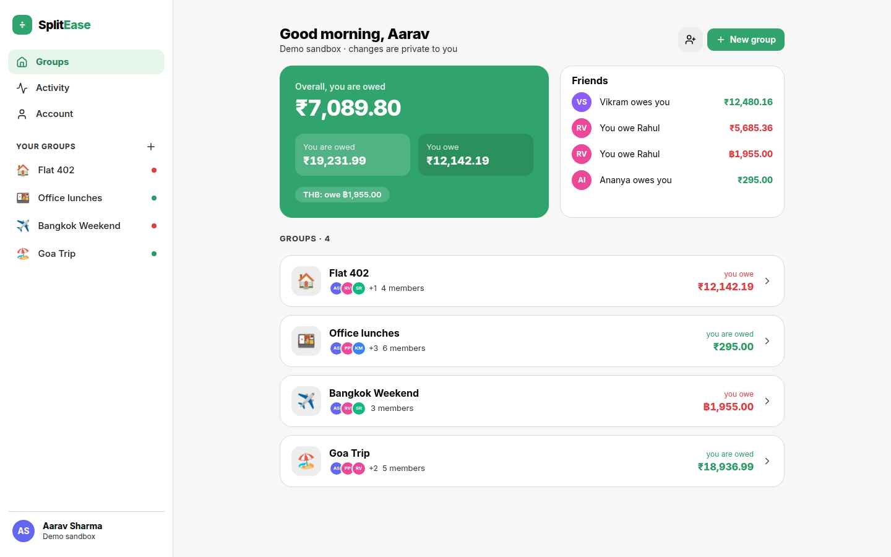
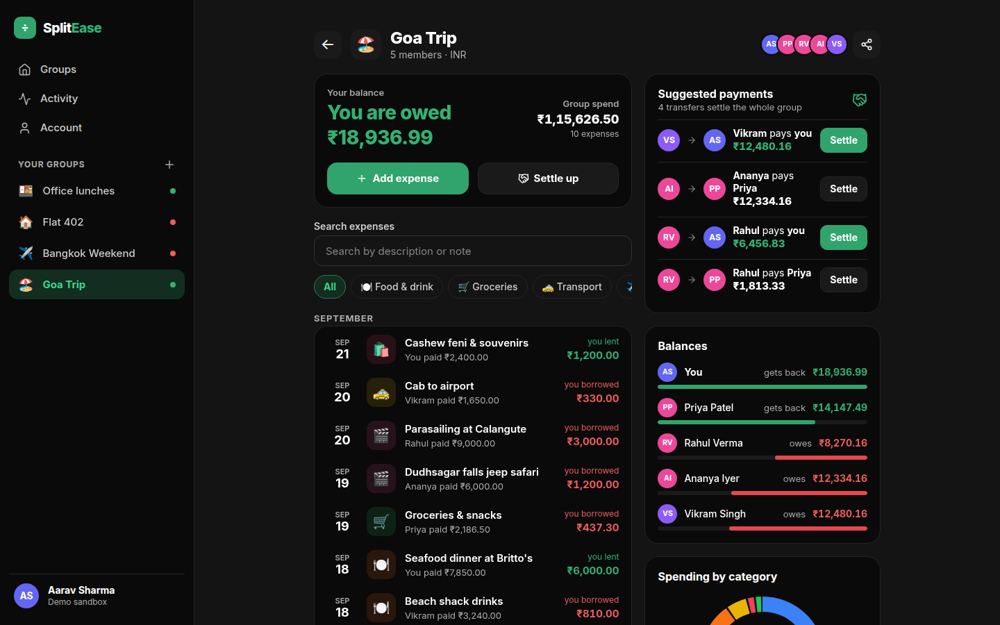
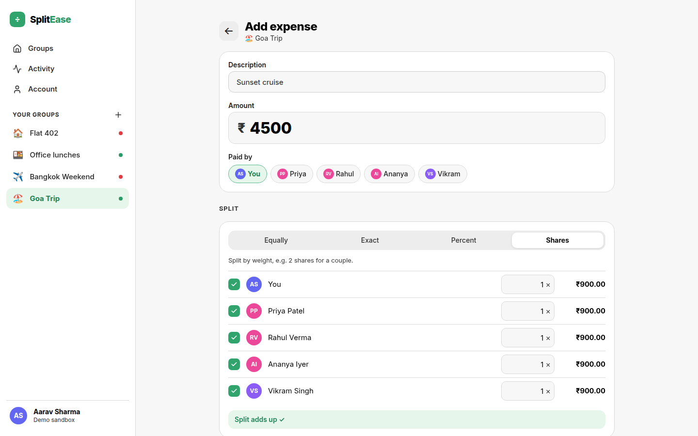
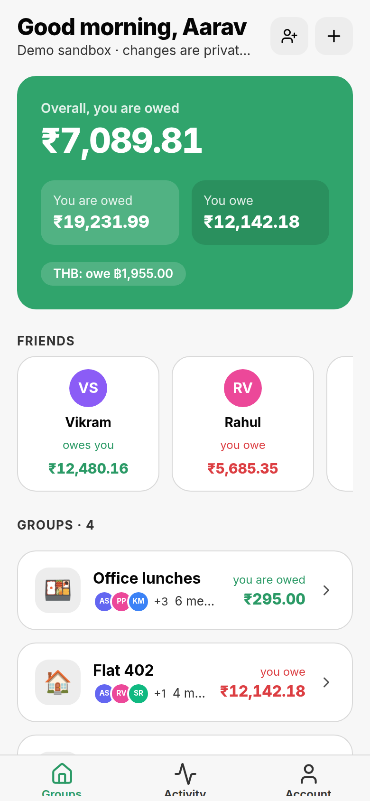
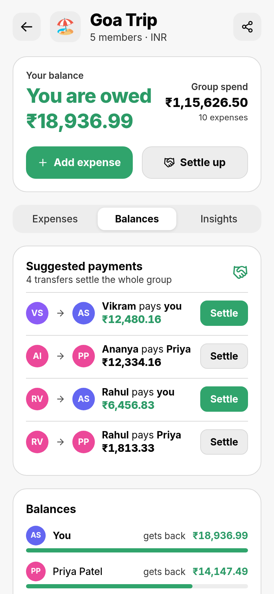
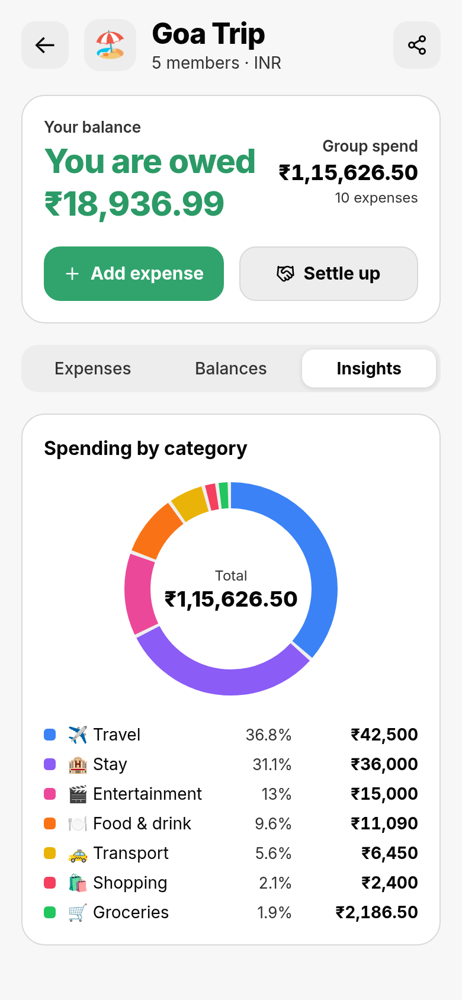
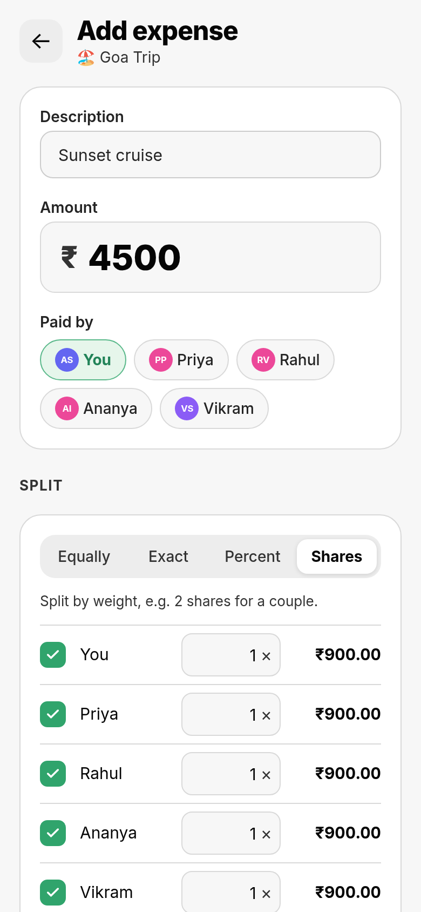
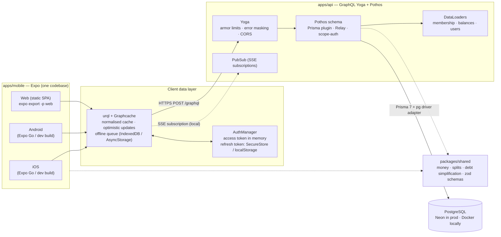

# SplitEase — split expenses, not friendships

SplitEase is a Splitwise-style app for shared costs: trips, flats, office lunches. **One React Native codebase runs on iOS, Android and the web**, backed by a **code-first GraphQL API**. It covers four split modes (equal, exact, percentage, shares), debt simplification, multi-currency groups, realtime updates and an offline-friendly cache.

**[Live demo](https://splitease-lalit.vercel.app)** — click **“Try the demo”**. You get a private sandbox with sample groups, no sign-up needed.



| Group with balances and simplified debts                          | Add expense (shares split)                                     |
| ----------------------------------------------------------------- | -------------------------------------------------------------- |
|  |  |

| Mobile dashboard                           | Suggested payments                              | Spending insights                               | Add expense                                  |
| ------------------------------------------ | ----------------------------------------------- | ----------------------------------------------- | -------------------------------------------- |
|  |  |  |  |

More in [`docs/screenshots/`](docs/screenshots) (dark mode, welcome page, expense list).

---

## Highlights

- **One codebase, three platforms.** Expo SDK 57, Expo Router and Tamagui. On wide screens (desktop web, tablets) the app shows a sidebar; on phones it uses bottom tabs. Haptics on native, dark mode everywhere.
- **GraphQL done properly.** GraphQL Yoga with Pothos (code-first, Prisma plugin, Relay connections, scope auth). Typed client documents come from GraphQL Code Generator, and urql uses Graphcache for a normalised cache.
- **Money is never a float.** Every amount is an integer in minor units (paise, cents). Rounding remainders are assigned with the largest-remainder method, so splits always add up to the exact total. The same split code runs on the client (live preview) and on the server (source of truth).
- **Debt simplification.** A greedy net-balance algorithm turns a web of IOUs into at most _n − 1_ payments, e.g. “Rahul pays you ₹6,456.83”. Property-based tests check that money is conserved.
- **Production-minded auth.** Argon2id password hashing and 15-minute JWT access tokens. Refresh tokens are opaque, stored only as an HMAC, rotated on every use, and reuse of an old token revokes the whole token family. Native apps keep the refresh token in the iOS Keychain or Android Keystore.
- **Realtime + optimistic + offline.** GraphQL subscriptions over SSE (polling on Vercel, explained below). New expenses show up optimistically, and a persisted Graphcache store queues mutations made offline.
- **Hardened API.** Query depth, cost, alias and token limits (GraphQL Armor), error masking, introspection disabled in production, CORS allow-list, and DataLoaders so a dashboard costs a fixed number of SQL queries.
- **Well tested.** **121 tests** in total: 56 unit/property tests for the shared maths, 43 API integration tests against real Postgres, and 22 component/unit tests for the app. ESLint, Prettier and strict TypeScript all pass in CI.

## Architecture



**Deployment:** two Vercel projects from the same repository. The web app is a static SPA from `apps/mobile`. The API is a Node.js serverless function from `apps/api` (`api/graphql.ts`), connecting to a Neon Postgres pooled endpoint.

### Repository layout

```
apps/
  api/        GraphQL API (Yoga + Pothos + Prisma 7). Runs as a Node server locally and as a Vercel function.
    api/        Vercel entry points (graphql.ts, health.ts)
    prisma/     schema, migrations, seed
    src/        schema/ (Pothos types), auth/, services/, context (DataLoaders), yoga.ts, server.ts
    test/       integration tests against real Postgres
  mobile/     Expo app (iOS / Android / web)
    src/app/    Expo Router routes (thin)
    src/screens, src/components, src/lib (auth, urql client, storage), src/graphql (documents + codegen)
    __tests__/  jest-expo + React Native Testing Library
packages/
  shared/     money, split and debt-simplification maths + zod schemas (used by both sides)
```

## Tech stack

| Layer          | Choice                                                                                          |
| -------------- | ----------------------------------------------------------------------------------------------- |
| App            | Expo SDK 57, React Native 0.86, React 19.2 (React Compiler), Expo Router, TypeScript (strict)   |
| UI             | Tamagui v2 (v5 config, light/dark themes), Inter, react-native-svg (charts), lucide icons       |
| GraphQL client | urql + `@urql/exchange-graphcache` (offline exchange), `@urql/exchange-auth`, `graphql-sse`     |
| Codegen        | GraphQL Code Generator: client preset (typed documents) + urql introspection for Graphcache     |
| API            | GraphQL Yoga 5, Pothos 4 (Prisma, Relay, Scope Auth plugins), GraphQL Armor, DataLoader         |
| Database       | PostgreSQL 17, Prisma 7 (`prisma-client` generator, `@prisma/adapter-pg`, `prisma.config.ts`)   |
| Auth           | Argon2id (`@node-rs/argon2`), JWT HS256 (`jose`), rotating opaque refresh tokens                |
| Validation     | Zod 4 schemas shared between client forms and server resolvers                                  |
| Testing        | Vitest + fast-check (property tests), Vitest integration tests on Postgres, jest-expo + RNTL 14 |
| Tooling        | npm workspaces, ESLint 9 flat config (`eslint-config-expo`), Prettier, GitHub Actions           |
| Hosting        | Vercel (static web + Node serverless function), Neon Postgres                                   |

### Why Tamagui?

I've used Tamagui in production, and it fits a universal app well. The same `XStack`/`YStack` primitives render to native views on iOS and Android, and to atomic CSS on the web. Themes give light and dark modes 12-step colour scales (`$green9`, `$color11`, …) that change automatically. Media-query props make the desktop layout easy. It runs **without the optimising compiler** (runtime only), so there's no Babel/Metro plugin to configure. The compiler can be added later for production web performance. NativeWind/Uniwind would also work; I chose Tamagui for its typed theme tokens and for consistency with my existing work.

### Why urql + Graphcache?

Graphcache gives normalised caching, **optimistic mutations** (`createExpense` adds the row immediately and `deleteExpense` removes it immediately), relay pagination helpers, and an **offline exchange** that persists the cache and queues failed mutations. It also stays small. After a money mutation, the update resolvers invalidate only the fields derived from it (`balances`, `simplifiedDebts`, `myBalance`, `expenses`, …), so the right queries refetch automatically.

## Features

- **Auth:** email + password sign-up and login, plus one-tap **“Try the demo”**. Sessions restore on launch. Logout revokes the refresh-token family.
- **Groups:** create a group with an emoji and a currency (INR by default; USD, EUR, GBP, AED, SGD, THB and JPY also supported). Members join with an **invite link** (`https://splitease-lalit.vercel.app/join/CODE` or `splitease://join/CODE`) or by typing the code. The owner can reset the link. Currency locks once expenses exist.
- **Expenses:** add, edit and delete expenses with payer, amount, category, date and notes. Four split modes: **equal / exact / percent / shares**. The form previews each share live and shows how much is left to assign (e.g. “₹250.00 left to assign”). Search, category filters and paginated lists are included.
- **Balances:** per-group net balances with bars, **simplified “A pays B ₹X” suggestions** with one-tap **Settle up**, and overall “you owe / you are owed” per currency plus per-friend totals on the dashboard.
- **Insights:** a spending-by-category donut chart (SVG, identical on native and web).
- **Activity feed:** across all groups (expense added/updated/deleted, payments, joins), with infinite scroll.
- **UX:** skeleton loaders, pull-to-refresh, empty and error states with retry, haptics, dark mode (system/light/dark toggle), accessible labels and roles, responsive layout.

## GraphQL API

Schema (generated, committed): [`apps/api/schema.graphql`](apps/api/schema.graphql). Overview:

```graphql
type Query {
  me: User
  dashboard: Dashboard! # per-currency totals + per-friend balances
  groups: [Group!]!
  group(id: ID!): Group! # FORBIDDEN unless you are a member
  expense(id: ID!): Expense!
  activity(first: Int, after: String): QueryActivityConnection! # Relay connection
  invitePreview(code: String!): InvitePreview!
}

type Mutation {
  signUp(input: SignUpInput!): AuthPayload!
  login(input: LoginInput!): AuthPayload!
  loginDemo: AuthPayload! # private sandbox, deleted after 24h
  refreshSession(refreshToken: String!): AuthPayload! # rotation + reuse detection
  logout(refreshToken: String!): Boolean!
  createGroup(input: GroupInput!): Group!
  updateGroup(id: ID!, input: GroupInput!): Group!
  joinGroup(code: String!): Group!
  regenerateInviteCode(groupId: ID!): Group!
  createExpense(groupId: ID!, input: ExpenseInput!): Expense!
  updateExpense(id: ID!, input: ExpenseInput!): Expense!
  deleteExpense(id: ID!): ID!
  settleUp(groupId: ID!, input: SettlementInput!): Settlement!
}

type Subscription {
  activityAdded(groupId: ID): Activity! # SSE
}

type Group {
  id: ID!
  name: String!
  emoji: String!
  currency: String!
  inviteCode: String!
  inviteUrl: String!
  members: [GroupMember!]!
  expenses(first: Int, after: String, search: String, category: ExpenseCategory): GroupExpensesConnection!
  balances: [MemberBalance!]! # nets sum to zero
  simplifiedDebts: [Debt!]! # "from pays to amount"
  myBalance: SafeInt!
  totalSpent: SafeInt!
  categoryBreakdown: [CategoryTotal!]!
  activity(first: Int): [Activity!]!
}

"Money in minor units. A JS safe integer, not GraphQL's 32-bit Int."
scalar SafeInt
```

Design notes:

- **Authorisation** lives in the resolvers. `scope-auth` requires a logged-in user, and every group-scoped field goes through `assertMember()`, which is batched per request with a DataLoader. Non-members get `FORBIDDEN`. Integration tests check that a non-member can't read a group, add an expense, settle up, rename the group or subscribe to it.
- **Errors:** domain errors are `GraphQLError`s with `extensions.code` (`UNAUTHENTICATED`, `FORBIDDEN`, `NOT_FOUND`, `BAD_USER_INPUT` with per-field `fields`, `CONFLICT`). Anything unexpected is masked as “Unexpected error.” in production.
- **N+1:** the Pothos Prisma plugin folds nested selections into one Prisma query per level. Computed fields use DataLoaders. Balances for _N_ groups cost **5 aggregate SQL queries in total** (`GROUP BY` over expenses, shares and settlements).
- **Hardening:** max depth 12, cost limit 5000, max 15 aliases, max 2000 tokens, and field suggestions blocked in production. **Introspection and GraphiQL are disabled in production**; the client's types come from the committed schema at build time. Persisted operations would be the next step (see limitations).

## Money handling

- All amounts are **integers in the currency's minor unit**. ₹1,250.50 is stored, sent and computed as `125050`. User input is parsed from its decimal _string_ (`parseMoney("1,250.50") → 125050`), never through `parseFloat`.
- A single expense is capped at 10⁹ minor units (₹1 crore), so it fits a Postgres `INTEGER`. Aggregates use the `SafeInt` scalar, because GraphQL `Int` is only 32-bit.
- Percentages are stored as **basis points** (`3333` = 33.33%) and must total exactly `10000`. Shares are integer weights.
- **Rounding:** `allocateByWeights` (largest-remainder / Hamilton method). Each person first gets `floor(amount × weight / totalWeight)`. The few leftover paise then go, one each, to the largest fractional remainders, with ties broken by user id. So ₹10.00 split three ways is always 334 / 333 / 333, whatever order the participants are listed in. Property tests check that the total always matches exactly, that no share is a full paisa or more away from its exact value, and that the result doesn't depend on input order.
- Formatting is done by hand (with Indian digit grouping for INR: `₹12,34,567.89`), so output is identical on Hermes, JSC and browsers.

## Debt simplification

Given every member's **net balance** (paid − owed ± settlements, which always sums to zero):

1. Split people into creditors (net > 0) and debtors (net < 0).
2. Repeatedly take the **largest debtor** and the **largest creditor**, and create a transfer for the smaller of the two amounts.
3. Subtract it from both. At least one of them is now at zero and drops out. Re-sort and repeat.

Each step settles at least one person, so _n_ people with non-zero balances need **at most n − 1 transfers**. Finding the true minimum is NP-hard (it reduces to subset-sum), and the greedy approach is optimal or close to it for real groups. Ties are broken by user id, so everyone sees the same plan. The property tests (fast-check, 300 random groups per property) check that:

- applying the transfers brings **every** balance to exactly 0 (money is conserved);
- there are at most _(non-zero members − 1)_ transfers, each a positive integer between two different people;
- only debtors pay and only creditors receive, and nobody pays or receives more than their balance.

Example from the demo “Goa Trip”: 10 expenses among 5 friends reduce to **4 payments**.

## Realtime on serverless — the honest version

- **Locally**, the API is one long-running Node process. Clients open a GraphQL **subscription over SSE** (`graphql-sse`; React Native uses `expo/fetch` for streaming). Yoga's in-memory PubSub pushes `activityAdded`, and Graphcache invalidates the affected group, so the screen refetches. Two browser windows update each other within a second, and this is verified in headless Chrome.
- **On Vercel**, each serverless instance has its own memory and long-lived responses hit function time limits, so an in-process PubSub can't fan out between instances. Production therefore uses **polling**: active screens refetch every 15 seconds, plus on focus, on app foreground and on pull-to-refresh. Optimistic updates keep your own changes instant. The app picks the mode automatically (`EXPO_PUBLIC_REALTIME`, defaulting to `poll` for `https://` APIs).
- **To get true realtime in production**, only `apps/api/src/pubsub.ts` needs to change: point `createPubSub` at a Redis/Upstash event target and host subscriptions on a long-running service. The client is already built for it.

## Token storage trade-offs

| Platform    | Access token (15 min) | Refresh token (30 days, rotating)                                                                                             |
| ----------- | --------------------- | ----------------------------------------------------------------------------------------------------------------------------- |
| iOS/Android | memory only           | `expo-secure-store` (Keychain / Keystore, `AFTER_FIRST_UNLOCK`)                                                               |
| Web         | memory only           | `localStorage`, plus [Web Locks](https://developer.mozilla.org/docs/Web/API/Web_Locks_API) to serialise refreshes across tabs |

An httpOnly `SameSite` cookie would be the stronger choice on the web. However, the app and API live on different `*.vercel.app` subdomains, and `vercel.app` is on the Public Suffix List, so browsers treat them as **cross-site** and increasingly block such cookies. To limit what an XSS bug could do with a stolen token:

- the refresh token is **opaque** and only its HMAC-SHA256 is stored;
- it is **rotated on every use**, and presenting an already-rotated token **revokes the whole family**;
- concurrent refreshes are single-flight in-app and serialised across tabs, so legitimate use never trips reuse detection.

With a custom domain (app and API on the same site), the refresh token could move to an httpOnly cookie without changing the rest of the design.

## Getting started

Prerequisites: Node 24 (npm 11), Docker.

```bash
git clone https://github.com/lalitkumarrajak/splitease && cd splitease
npm install                       # also builds packages/shared
cp apps/api/.env.example apps/api/.env
npm run db:up                     # Postgres 17 on localhost:5436 (container: splitease-db)
npm run generate                  # Prisma client + schema.graphql + typed GraphQL documents
npm run db:migrate                # apply migrations
npm run db:seed                   # demo account: demo@splitease.app / splitease-demo
npm run dev:api                   # http://localhost:4600/graphql (GraphiQL in dev)
```

### Web

```bash
npm run dev:web                   # Expo dev server → http://localhost:8081
# or a production build:
npm run build:web                 # apps/mobile/dist (static SPA)
```

### iOS / Android with Expo Go

1. Install **Expo Go** on your phone (App Store / Play Store). Your phone and computer must be on the same Wi-Fi.
2. Run `npm run dev:api` and `npm run dev:mobile`, then scan the QR code (iOS: Camera app; Android: Expo Go).
3. The app finds the API automatically via your computer's LAN IP (taken from the Metro host). To point a device at the deployed API instead, set `EXPO_PUBLIC_API_URL=https://splitease-api-lalit.vercel.app/graphql` in `apps/mobile/.env`. If your network isolates devices, use `npx expo start --tunnel`.

Every native module used (SecureStore, Haptics, SVG, Clipboard, AsyncStorage, NetInfo, Font) is included in Expo Go, so no development build is needed. Deep links: `splitease://join/CODE` (Expo Go uses `exp://…/--/join/CODE`).

### Ports

| Service           | Port |
| ----------------- | ---- |
| Postgres (Docker) | 5436 |
| GraphQL API       | 4600 |
| Expo web (dev)    | 8081 |

## Environment variables

**API** (`apps/api/.env`, Vercel project “splitease-api”):

| Variable              | Meaning                                                                                    |
| --------------------- | ------------------------------------------------------------------------------------------ |
| `DATABASE_URL`        | Runtime connection string. On Neon use the **pooled** URL (`…-pooler…?sslmode=require`).   |
| `DIRECT_URL`          | Used only by the Prisma CLI (`db:migrate`). On Neon use the **direct** (non-pooled) URL.   |
| `JWT_ACCESS_SECRET`   | HS256 key for access tokens, ≥ 32 chars (`openssl rand -base64 48`).                       |
| `JWT_REFRESH_SECRET`  | HMAC key for hashing refresh tokens at rest, ≥ 32 chars, different from the access secret. |
| `CORS_ORIGINS`        | Comma-separated browser origins, e.g. `https://splitease-lalit.vercel.app`.                |
| `WEB_APP_URL`         | Base URL for invite links (default `https://splitease-lalit.vercel.app`).                  |
| `DATABASE_POOL_MAX`   | Optional, `pg` pool size per instance (default 5).                                         |
| `ALLOW_INTROSPECTION` | Optional, `true` re-enables introspection in production (default `false`).                 |

**Web** (`apps/mobile/.env`, Vercel project “splitease-web”):

| Variable               | Meaning                                                                                         |
| ---------------------- | ----------------------------------------------------------------------------------------------- |
| `EXPO_PUBLIC_API_URL`  | GraphQL endpoint, e.g. `https://splitease-api-lalit.vercel.app/graphql`. Inlined at build time. |
| `EXPO_PUBLIC_REALTIME` | Optional, `sse` or `poll` (defaults to `poll` when the API URL is `https://`).                  |
| `EXPO_PUBLIC_WEB_URL`  | Optional, the public web URL.                                                                   |

## Testing

```bash
npm test                      # everything (needs the Docker Postgres for the API suite)
npm test -w @splitease/shared # 56 unit + property tests (money, splits, debt simplification, schemas)
npm test -w @splitease/api    # 43 integration tests: GraphQL over Yoga against Postgres (splitease_test DB)
npm test -w @splitease/mobile # 22 jest-expo + React Native Testing Library tests
npm run lint && npm run format:check && npm run typecheck
```

- **Shared:** every split mode with rounding edge cases (₹0.05 between 3 people, more people than paise, 33.33/33.33/33.34%, zero weights, order independence) and fast-check properties for allocation and debt simplification.
- **API:** sign-up/login, argon2id hashing, refresh rotation, reuse detection revoking the family, a concurrent-refresh race, expiry, logout; group create/join/invite reset; all split modes end-to-end; validation errors; balances checked against the pure function; settle-up bringing balances to zero; edit/delete with activity log; pagination, search and category filters; dashboard totals; SSE subscription delivery; non-member authorisation; depth/alias limits; introspection off in production; demo sandbox isolation and cleanup.
- **App:** the expense form (live split preview, “left to assign”, percentage prefill, integer submission, validation), the login form (shared zod validation, session hand-off, server field errors), expense rows, the activity copy, and `AuthManager` (rotation, single-flight refresh, sign-out on rejection, offline restore).

CI (`.github/workflows/ci.yml`) runs everything from a clean checkout: `npm ci` → `npm run generate` (Prisma client, schema, codegen) → schema drift check → lint → Prettier → typecheck → tests with a Postgres service → `expo export -p web`.

## Deployment (Neon → Vercel ×2)

1. **Neon:** create a project and copy both connection strings: **pooled** (host contains `-pooler`) and **direct**.
2. **Migrate & seed** from your machine:
   ```bash
   DIRECT_URL="<neon direct url>" DATABASE_URL="<neon pooled url>" npm run db:migrate
   DATABASE_URL="<neon pooled url>" JWT_ACCESS_SECRET=... JWT_REFRESH_SECRET=... npm run db:seed
   ```
3. **API project** — Vercel → New Project → import the repo → **Root Directory `apps/api`**. `apps/api/vercel.json` sets the install command (`npm ci` at the repo root for the workspace), the build (`prisma generate`), the function and the `/graphql` → `/api/graphql` and `/health` rewrites. Add the API env vars above. Check `https://splitease-api-lalit.vercel.app/health` → `{"ok":true,"database":"up"}`.
4. **Web project** — New Project → same repo → **Root Directory `apps/mobile`**. `apps/mobile/vercel.json` installs from the repo root, runs codegen and `expo export -p web`, serves `dist` with an SPA fallback and long-term caching for hashed assets. Set `EXPO_PUBLIC_API_URL=https://splitease-api-lalit.vercel.app/graphql`.
5. Set `CORS_ORIGINS=https://splitease-lalit.vercel.app` on the API project and redeploy it.

Prisma on serverless: Prisma 7 has no query-engine binary. The generated client uses the `pg` driver adapter with a small per-instance pool (`attachDatabasePool` releases idle connections on Fluid compute) against Neon's PgBouncer endpoint. The client is cached on `globalThis` across warm invocations.

## Known limitations

- **Realtime in production is polling** (see above). Subscriptions work against the long-running local server.
- **No persisted queries yet.** Introspection is off and the armor limits are on, but the API still accepts arbitrary operations. The next step is codegen's persisted-documents output with Yoga's `usePersistedOperations`.
- `npm audit` reports advisories, mostly in build and test tooling (Expo CLI/Metro, Jest, the Prisma CLI). The one in the runtime path, `@graphql-tools/utils` (pulled in by GraphQL Yoga 5), has no stable fixed release yet; it will be bumped when Yoga ships one.
- **Rate limiting** of `login` / `loginDemo` is not implemented. Vercel's firewall or an Upstash rate limiter would be the production fix.
- **Expenses use the group's currency** (multi-currency means across groups); there is no FX conversion inside a group.
- No receipts/attachments, recurring expenses, email invites or push notifications. Users can't leave a group or be removed yet.
- Native was checked with strict typechecking, jest-expo tests, `expo-doctor` (21/21 checks) and `expo export -p ios -p android` (both Hermes bundles build). It has not yet been run on a physical device or simulator, and there are no store builds (EAS) yet. The web build was tested end-to-end in headless Chrome.

## Scripts

| Command               | What it does                                                              |
| --------------------- | ------------------------------------------------------------------------- |
| `npm run dev:api`     | API with hot reload on :4600 (GraphiQL at `/graphql`)                     |
| `npm run dev:web`     | Expo web dev server on :8081                                              |
| `npm run dev:mobile`  | Expo dev server for Expo Go                                               |
| `npm run generate`    | Prisma client + `schema.graphql` + typed GraphQL documents                |
| `npm run db:migrate`  | `prisma migrate deploy` (uses `DIRECT_URL`, falls back to `DATABASE_URL`) |
| `npm run db:seed`     | (Re)create the demo account and its groups                                |
| `npm run build:web`   | Static web build in `apps/mobile/dist`                                    |
| `npm run screenshots` | Regenerate `docs/screenshots` from a running web build                    |

## License

[MIT](LICENSE) © Lalit Rajak
